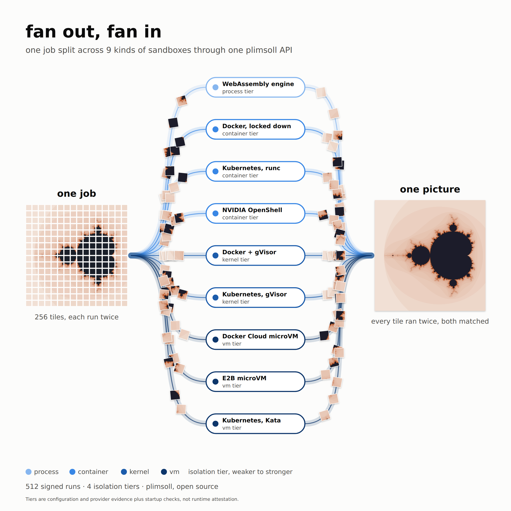
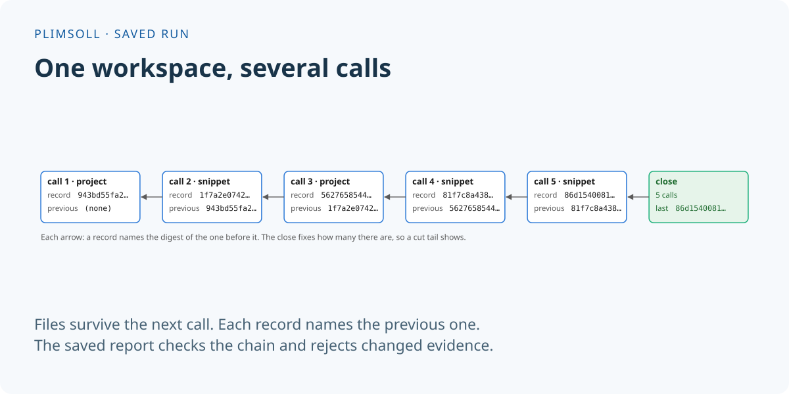
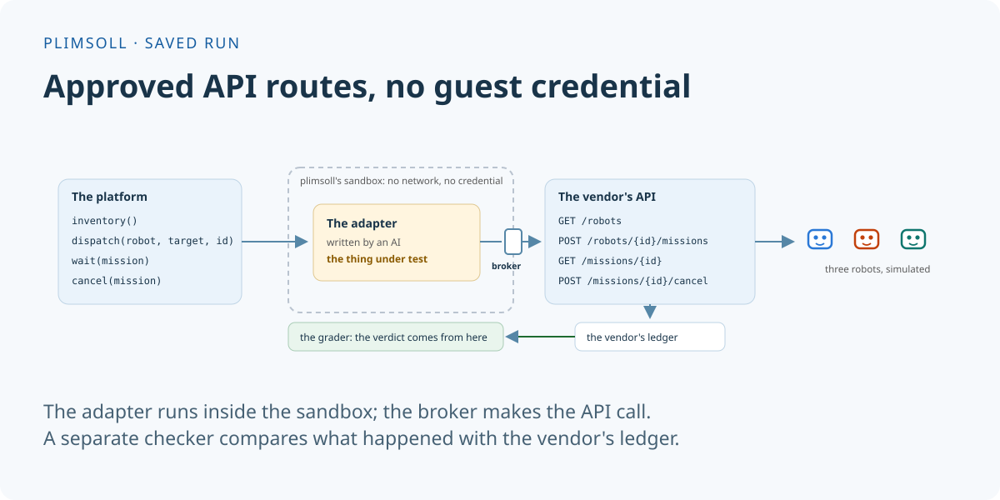
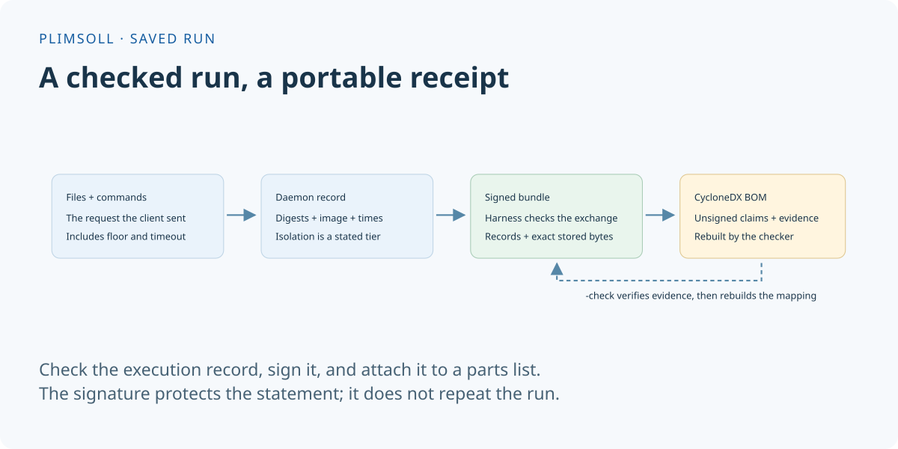

# plimsoll

**Run agent-written code across sandbox [providers](docs/trainers/glossary.html#provider), control which APIs it can call,
and check a record of what ran.**

[](https://github.com/plimsollmark/plimsoll/actions/workflows/audit.yml)
[](https://github.com/plimsollmark/plimsoll/actions/workflows/gvisor.yml)
[](https://pkg.go.dev/github.com/plimsollmark/plimsoll)
[](https://github.com/plimsollmark/plimsoll/releases)
[](LICENSE)

[Run the quickstart](#run-something-locally) · [See what it does](#what-you-can-do) ·
[Agent connections](#connect-an-agent) · [Choose a provider](#choose-a-provider)

Use one interface for disposable runs and persistent workspaces. Require a minimum
<dfn>*isolation tier*</dfn>, how strong the wall around a run must be, on each request.
Keep upstream API credentials outside <dfn>*guest*</dfn> code, the code running inside
the sandbox, and check the service's account of the input and result. Sign records separately
when you need saved evidence. An API is a service's callable interface, such as
an endpoint that places an order or queries a database.

<p align="center">
  <a href="docs/example-programs.md"></a>
</p>

**One job, every sandbox.** A Mandelbrot picture is a fractal, an image made by
repeatedly applying a small formula. The example splits it into
tiles and sends pieces to sandboxes working at once. That is <dfn>*fan-out*</dfn>; assembling
the results is *fan-in*. Each tile runs twice so the example can compare answers
across the nine configurations shown.
[INTERNAL · example guide and reproduction commands →](docs/example-programs.md).

## Run something locally

With Go installed:

```sh
git clone https://github.com/plimsollmark/plimsoll
cd plimsoll
SANDBOX_PROVIDER=wasm go run ./examples/minimal
```

Cloning and fetching the <dfn>*pinned*</dfn> Go toolchain, fixed to one exact version, and
dependencies use the network.
The example's execution needs no daemon, Docker, credentials or outbound network.
Among the output, look for:

```text
provider   wasm
isolation  process
exit code  0
stdout     {"Engineering":59000000,"Sales":20300000,"Operations":9800000}
```

**This is a development example.** `wasm` runs <dfn>*QuickJS*</dfn>, a small JavaScript
engine, in <dfn>*WebAssembly*</dfn>, a portable bytecode format, inside the calling process.
Its `process` tier is not an operating-system boundary; an engine <dfn>*escape*</dfn>, a
bug that lets code act outside its sandbox, reaches that process. For hostile
production code, use a verified `kernel` provider with a separate user-space kernel,
or a `vm` provider with its own virtual machine.

The example explicitly selects a provider. The library and `plimsolld`, the
Plimsoll server, default to **Disabled**, which runs nothing.
[INTERNAL · getting started →](docs/getting-started.md) covers a running server,
caller credentials, isolation requirements and switching to <dfn>*gVisor*</dfn>, a separate
user-space kernel, without changing the client.

## What you can do

A <dfn>*provider*</dfn> is the backend that executes code. A <dfn>*run record*</dfn> is the server's
account of the submitted input, returned result and execution environment, bound
with content hashes, <dfn>*fingerprints*</dfn> of those bytes. The official clients recompute
the hashes before accepting an answer.

| Job | What Plimsoll supplies | Go deeper |
|---|---|---|
| Run code | JavaScript snippets, projects containing files and ordered build/test/run steps, and compiled simulation modules on Docker. | [INTERNAL · payloads and examples →](docs/example-programs.md) |
| Keep a workspace | <dfn>*Sessions*</dfn> keep one sandbox for many calls and retain its files between them. Supported Python and JavaScript interpreters retain variables too; warm pools keep sandboxes ready to claim. | [INTERNAL · sessions and pools →](docs/sessions.md) |
| Limit API access | A per-run <dfn>*grant*</dfn> permits listed routes through a <dfn>*broker*</dfn>, a proxy outside the sandbox. The broker attaches the upstream credential; guest code never holds it. Generate routes, an injected client and the description of a <dfn>*tool*</dfn>, a named action an agent can call, from one OpenAPI document, a machine-readable API specification. | [INTERNAL · capability grants →](docs/capability-grants.md) |
| Choose where code runs | Require an isolation tier on each request. A placement library selects among servers and retries elsewhere only on a request-bound refusal that says execution was not <dfn>*dispatched*</dfn>, never handed to the provider to run. | [INTERNAL · placement and retries →](docs/placement.md) |
| Check, sign and replay | Checked run records, linked session records, signed bundles and separately signed statements. The signing tool runs outside the server; the server holds no <dfn>*signing key*</dfn>, the private key that makes signatures. | [INTERNAL · records and signing →](docs/run-records.md) |
| Find wasted API calls | The efficiency advisor reports repeated or avoidable calls using route templates, counts and timings. It runs after execution, calls no model and never changes the result. | [INTERNAL · efficiency advisor →](docs/efficiency-advisor.md) |
| Operate the service | Caller authentication, per-caller limits and budgets, audit logs and metrics. <dfn>*Hardened mode*</dfn>, a startup setting, refuses startup unless its required safeguards are configured. | [INTERNAL · hardened mode →](docs/hardened-mode.md) |

Payload, session and grant support vary by provider. The server's `Describe` call
reports what its configured backend supports.

### More evidence workflows

A signed <dfn>*receipt*</dfn> is like a stamped delivery slip: it identifies the contents and
what the signer said about them. It does not independently repeat the inspection.

- **Match a run to its sandbox.** Record version 4 includes sandbox instance
  identity; Kubernetes supplies the pod's unique ID, so an outside observation log
  can be joined to the run. New live calls use protocol 4. Upgrade server and
  clients together; stored-record verifiers also read published versions 1 through 4.
- **Check test results against the code revision they tested.** The pull-request
  recipe produces signed <dfn>*in-toto*</dfn> statements, a standard layout for signed claims;
  JUnit test reports; and Cobertura coverage reports showing which code the tests
  exercised. Its challenge includes an
  honest receipt and deliberately wrong evidence the checker must reject.
  [INTERNAL · test receipt and challenge →](examples/pr-receipt/README.md).
- **Check timestamps and signing roles offline.** Supply trusted keys, expected
  artifact hashes and timestamp roots separately from the receipt. The generic
  checker verifies the signed claims and outside timestamps without a network call.
  [INTERNAL · offline receipt verification →](docs/receipt-verification.md).
- **Collect a coding session's execution records.** Hooks label calls so records
  can be grouped and checked. This covers labelled Plimsoll calls, not commands an
  agent runs elsewhere or proof of who originated them.
  [INTERNAL · coding-session recipe →](examples/agent-session/README.md).

Also included is an **experimental dependency-log reader** for gVisor's host-side
system-call logs. It has explicit observation gaps. The signed dependency-behaviour
receipt remains a separate unfinished step.
[INTERNAL · reader, fixtures and coverage limits →](examples/dependency-receipt/README.md).

## Choose a provider

Each `plimsolld` serves one provider. Clients can select among several servers
through the placement library. Tiers describe the boundary around a run, weakest
first: `process`, `container`, `kernel`, `vm`.

| Provider setting | Boundary and reported tier | Where it fits |
|---|---|---|
| `wasm` | QuickJS inside the server: `process`. Snippets only. | Fast local development; no operating-system isolation. |
| `docker` | Default Docker runtime: `container`. Verified gVisor runtime (`runsc`): `kernel`. | Runs and persistent workspaces on your infrastructure. [INTERNAL · gVisor setup →](docs/gvisor.md) |
| `e2b` | <dfn>*E2B*</dfn>, a hosted service, runs each sandbox in a <dfn>*microVM*</dfn>, a small virtual machine, under <dfn>*Firecracker*</dfn>, the open-source monitor AWS built for them: `vm`. | Hosted runs and sessions, billed while active. [INTERNAL · E2B setup →](e2b/README.md) |
| `dockercloud` | <dfn>*Docker Cloud Sandboxes*</dfn>, Docker's hosted service, one microVM per run: `vm`. | Hosted runs. The default <dfn>*Connect*</dfn> API, an RPC protocol over ordinary HTTP, supports grants and hardened mode; the REST API has narrower support. [INTERNAL · API differences and setup →](docs/dockercloud.md) |
| `openshell` | <dfn>*OpenShell*</dfn>, NVIDIA's agent sandbox runtime, through its gateway: `container`. | Existing OpenShell deployments; runs and sessions. [INTERNAL · OpenShell setup →](docs/openshell.md) |
| `agentsandbox` | Kubernetes pod from a warm pool: `vm` with supported <dfn>*Kata*</dfn> runtime classes (a small virtual machine per pod), `kernel` with gVisor, `container` with <dfn>*runc*</dfn>, Docker's default, which shares the host kernel. Other classes are refused. | Deployments of <dfn>*agent-sandbox*</dfn>, the Kubernetes component that lends ready sandbox pods; the tier is read from the pod's runtime class. [INTERNAL · Kubernetes setup →](docs/agentsandbox.md) |
| Unset | Disabled: no code runs. | <dfn>*Fail-closed*</dfn> server and factory default: with nothing set, nothing runs. |

**A tier is configuration and provider evidence plus startup checks, not hardware
<dfn>*attestation*</dfn>**, cryptographic proof of the running system. Request a minimum tier;
a weaker provider refuses before dispatch. A plain container is not a separate
kernel, and WebAssembly here is not a VM boundary.
[INTERNAL · isolation evidence and limits →](docs/isolation-tiers.md).

## Real runs you can inspect

<table>
  <tr>
    <td width="50%" valign="top">
      <a href="docs/example-programs.md"></a><br>
      <strong>One image, parallel jobs</strong><br>
      Tiles go to nine sandbox configurations at once, and the matching answers are checked.<br>
      <a href="docs/example-programs.md">INTERNAL · fan-out source and reproduction guide →</a>
    </td>
    <td width="50%" valign="top">
      <a href="https://plimsollmark.github.io/plimsoll/examples/sessions/index.html"></a><br>
      <strong>One workspace, several calls</strong><br>
      A failing test, an in-place fix and a passing test, with files kept and records linked.<br>
      <a href="https://plimsollmark.github.io/plimsoll/examples/sessions/index.html">INTERNAL · rendered session report →</a>
    </td>
  </tr>
  <tr>
    <td width="50%" valign="top">
      <a href="https://plimsollmark.github.io/plimsoll/examples/adapter/index.html"></a><br>
      <strong>API access without the credential</strong><br>
      An agent-written adapter reaches only approved routes. A separate checker catches duplicate orders.<br>
      <a href="https://plimsollmark.github.io/plimsoll/examples/adapter/index.html">INTERNAL · rendered adapter report →</a>
    </td>
    <td width="50%" valign="top">
      <a href="https://plimsollmark.github.io/plimsoll/examples/sbom/index.html"></a><br>
      <strong>A checked run, a portable receipt</strong><br>
      Execution evidence travels in CycloneDX, a standard software parts-list format.<br>
      <a href="https://plimsollmark.github.io/plimsoll/examples/sbom/index.html">INTERNAL · rendered receipt report →</a>
    </td>
  </tr>
</table>

The simulation examples remain available too: an agent-written program balancing a
pole on a moving cart, <dfn>*controllers*</dfn> (programs that steer a simulated system) compiled to WebAssembly, and a fixed batch of
hand-authored controllers compared across providers. The fixed batch is not model
training. Recorded timings describe those runs, not controlled provider benchmarks.
[INTERNAL · all examples and reproduction commands →](docs/example-programs.md).

## Connect an agent

Use the clients directly, add a framework tool, or connect through **<dfn>*MCP*</dfn> (Model
Context Protocol)**, the standard interface through which an agent calls tools.
SDK means software development kit; ADK means Google's Agent Development Kit.

| Connection | Start here |
|---|---|
| Go package or remote client | [INTERNAL · embedding and server quickstart →](docs/getting-started.md) |
| Python client | [INTERNAL · install and use →](clients/python/README.md) |
| TypeScript client | [INTERNAL · install and use →](clients/typescript/README.md) |
| MCP for coding agents | [INTERNAL · build and configure the MCP server →](clients/mcp/README.md#setup). Includes the Reflection Mirror connection recipe. |
| Python shell-and-files workspace | [INTERNAL · workspace interface →](clients/python/README.md#agent-workspace) |
| Claude Managed Agents | [INTERNAL · self-hosted worker adapter →](clients/python/README.md#claude-managed-agents-self-hosted-worker) |
| OpenAI Agents SDK | [INTERNAL · sandbox provider adapter →](clients/python/README.md#openai-agents-sdk-sandbox-provider) |

These framework adapters give an agent a code-execution tool or executor. The guides
explain provider requirements and whether files and interpreter state persist.
<dfn>*Trigger.dev*</dfn>, one of them, is a hosted job runner for TypeScript.

<!-- integrations table: generated from the integration pages' data; edit that, not these rows -->
| Framework | Package or extra | Guide | See a run |
|---|---|---|---|
| Vercel AI SDK | `@plimsollmark/client/ai-sdk` | [Vercel AI SDK guide (INTERNAL · documentation →)](docs/ai-sdk.md) | [Vercel AI SDK page (INTERNAL · plimsoll site →)](https://plimsollmark.github.io/plimsoll/integrations/vercel-ai-sdk/index.html) |
| Google ADK | `plimsoll-client[adk]` | [Google ADK guide (INTERNAL · documentation →)](docs/google-adk.md) | [Google ADK page (INTERNAL · plimsoll site →)](https://plimsollmark.github.io/plimsoll/integrations/google-adk/index.html) |
| Agno | `plimsoll-client[agno]` | [Python client guide, Agno and CrewAI tools (INTERNAL · documentation →)](clients/python/README.md#agno-and-crewai-tools) | [Agno page (INTERNAL · plimsoll site →)](https://plimsollmark.github.io/plimsoll/integrations/agno/index.html) |
| CrewAI | `plimsoll-client[crewai]` | [Python client guide, Agno and CrewAI tools (INTERNAL · documentation →)](clients/python/README.md#agno-and-crewai-tools) | [CrewAI page (INTERNAL · plimsoll site →)](https://plimsollmark.github.io/plimsoll/integrations/crewai/index.html) |
| [Trigger.dev](docs/trainers/glossary.html#trigger-dev) | `@plimsollmark/client/trigger` | [Trigger.dev guide (INTERNAL · documentation →)](docs/trigger-dev.md) | [Trigger.dev page (INTERNAL · plimsoll site →)](https://plimsollmark.github.io/plimsoll/integrations/trigger-dev/index.html) |
| Mastra | `@plimsollmark/client/mastra` | [TypeScript client guide, Mastra (INTERNAL · documentation →)](clients/typescript/README.md#mastra) | [Mastra page (INTERNAL · plimsoll site →)](https://plimsollmark.github.io/plimsoll/integrations/mastra/index.html) |
<!-- end of the integrations table -->

For a complete Trigger.dev chat task, use the
[EXTERNAL · deployable starter repo ↗](https://github.com/plimsollmark/plimsoll-trigger-starter).
It includes a check that two <dfn>*cells*</dfn>, pieces of code run in one kept
interpreter, share it through a real server, without making a model call.

## Limits and project status

Plimsoll is **pre-1.0**. Keep the server and clients on matching protocol versions.
The daemon checks provider configuration and runs a startup smoke test; that does
not make the operator's machine independently trustworthy. Signatures identify a
signing key and protect recorded statements from alteration. They do not prove
correct code, complete tests or secure isolation.

Treat an unmarked error as a call that may have executed. Automatic retry is safe
only when a refusal bound to that request says nothing was dispatched.
[INTERNAL · results and safe retries →](docs/run-results.md).

Audit logs and advisor traces keep route templates, counts and timings, rather than
API bodies or credentials. A caller-supplied correlation ID can join a run to the
caller's own logs without copying their payload into Plimsoll's telemetry.
[INTERNAL · telemetry boundary →](docs/efficiency-advisor.md).

Local checks and automated public checks cover the core, clients, record formats
and Docker under both its default runtime and gVisor. Public checks do not exercise the paid E2B or
Docker Cloud services. No independent third-party security audit is claimed.
[INTERNAL · contributing and verification →](CONTRIBUTING.md) ·
[INTERNAL · security policy →](SECURITY.md) ·
[INTERNAL · full limitations →](docs/limitations.md).

## Find the right documentation

| What you want to do | Start here |
|---|---|
| Understand the idea before the API | [INTERNAL · plain-English browser lesson →](https://plimsollmark.github.io/plimsoll/trainers/plain-english.html) |
| Run a server or embed the package | [INTERNAL · getting started →](docs/getting-started.md) |
| Learn through working examples | [INTERNAL · example catalog →](docs/example-programs.md) |
| Configure callers and credentials | [INTERNAL · caller administration →](docs/callers.md) |
| Prepare for production | [INTERNAL · hardened mode →](docs/hardened-mode.md) and [INTERNAL · guest images and dependencies →](docs/guest-dependencies.md) |
| Extend or contribute | [INTERNAL · embedding seams →](docs/seams.md) and [INTERNAL · architecture index →](AGENTS.md) |
| Look up an unfamiliar word | [INTERNAL · glossary →](https://plimsollmark.github.io/plimsoll/trainers/glossary.html) |

The name comes from the <dfn>*Plimsoll line*</dfn>, the load limit painted on a ship's hull:
a limit stated where someone can check it. Here, every run states its isolation tier.

## License

[Apache-2.0](LICENSE).
